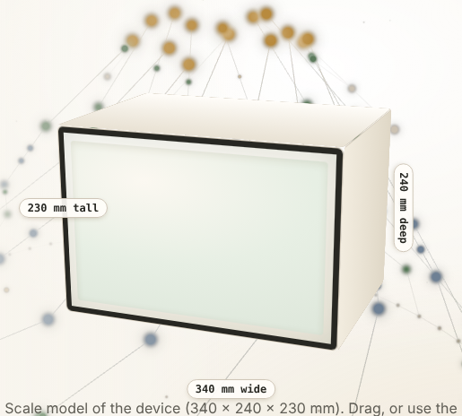
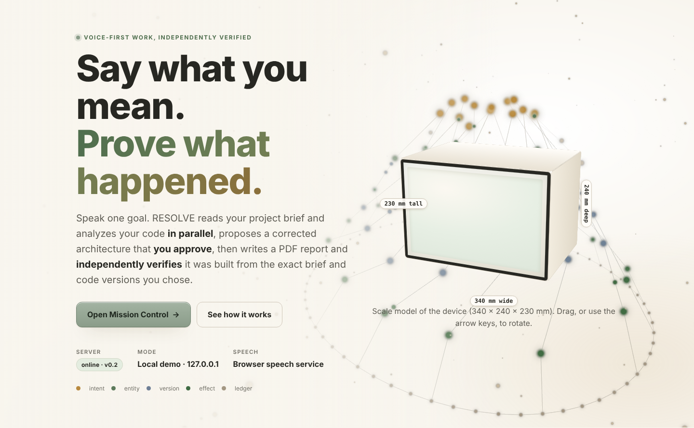
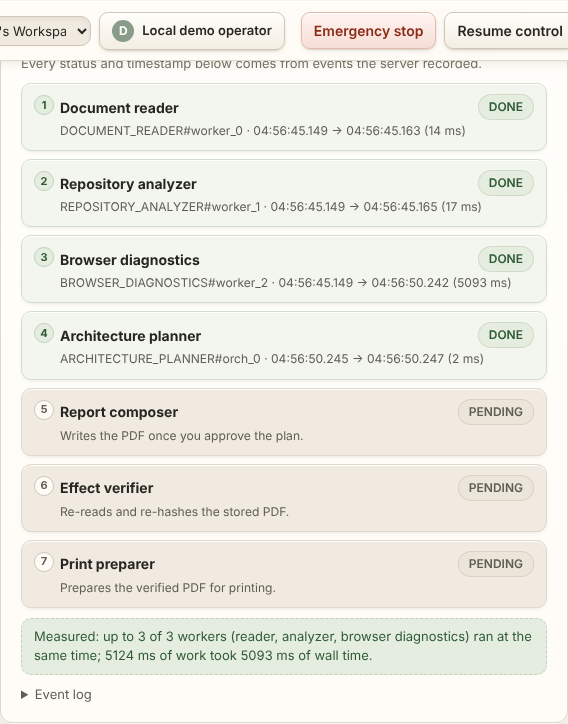
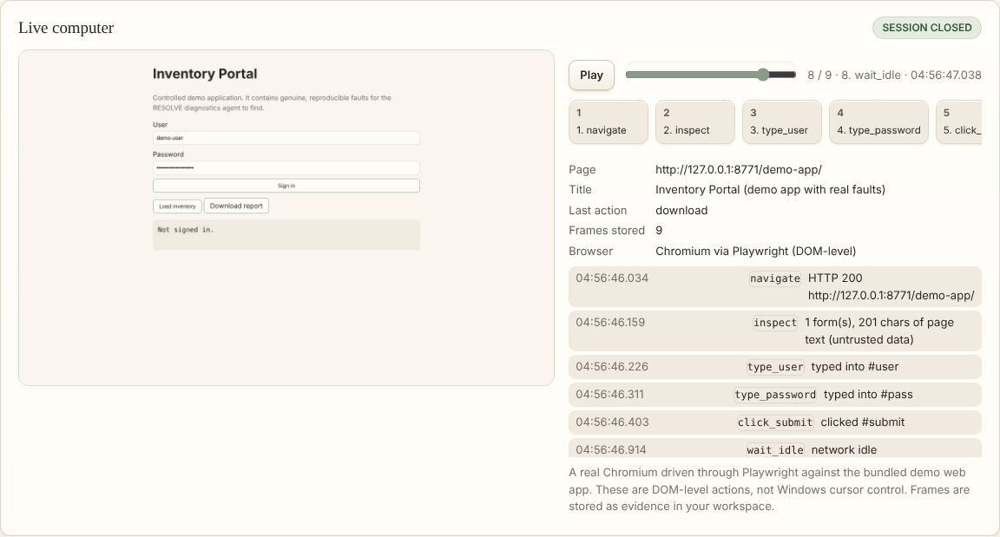
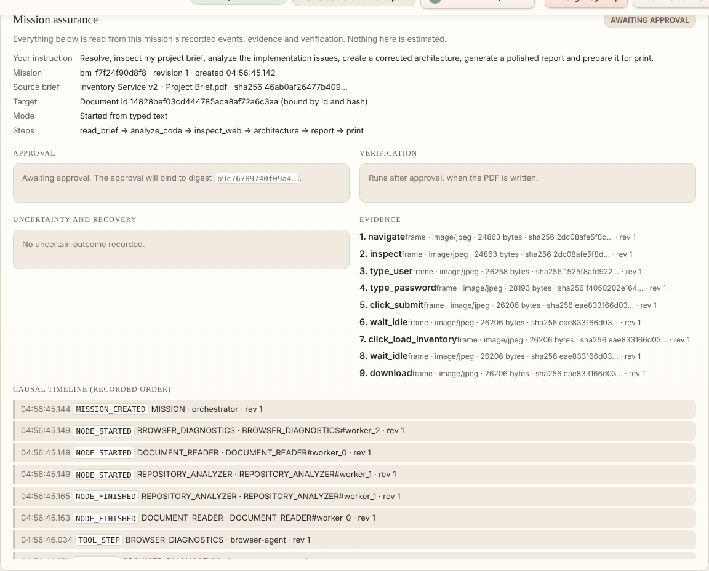
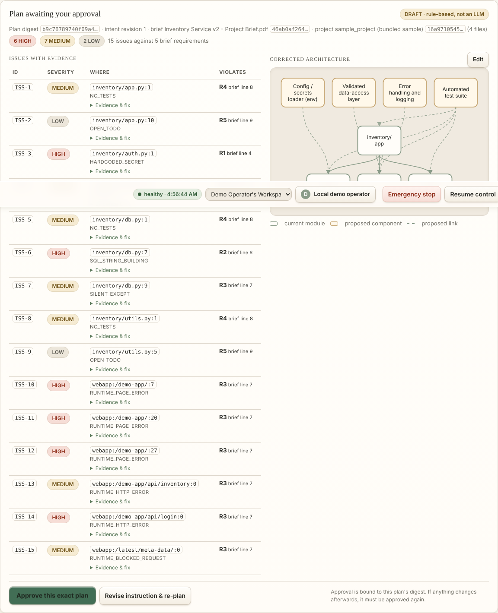
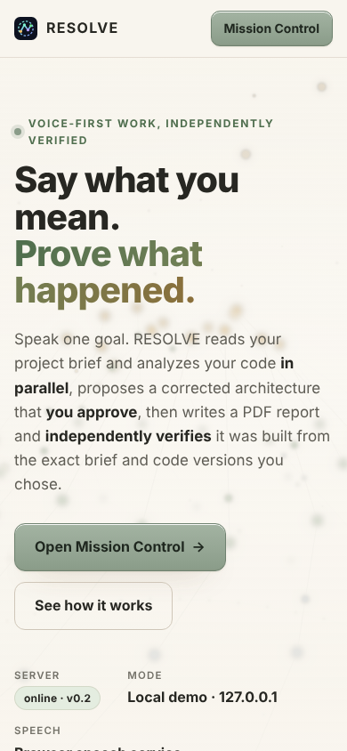
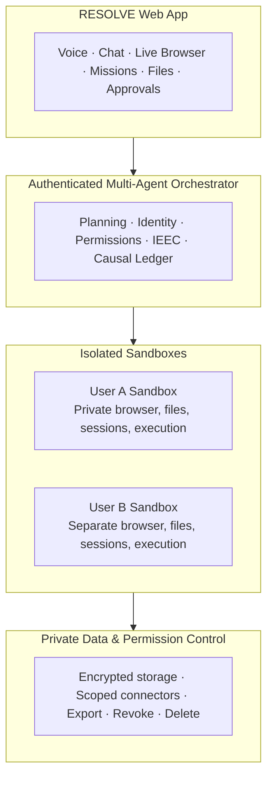
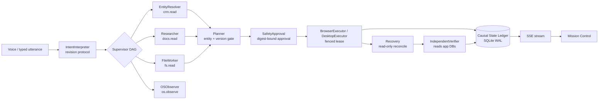

# RESOLVE: Wisper and Solve

# RESOLVE — the live AI cloud computer

> Say one goal. Watch a real cloud browser work. Approve the exact plan. Get a verified PDF — and see the evidence for every step.

<p align="center">
  
  
</p>

## What is new (live product)

| Area | What you can see | How it is produced |
|---|---|---|
| **Live computer** | A real Chromium session against a controlled web app, with each captured frame, a scrubber, play/pause and a filmstrip | Frames are stored as tenant evidence while the browser runs; the viewer loads them from the server |
| **Mission workers** | Document reader, repository analyzer, browser diagnostics, planner, composer, verifier, print preparer — with real start/finish times | Recorded `NODE_STARTED` / `NODE_FINISHED` events, not a script |
| **Mission assurance** | Approval digest, verification checks, uncertainty reasons, the causal timeline and evidence list | Read from the mission's recorded state |
| **3D model** | A scale model of the device, drawn with CSS 3D; drag to rotate, arrow keys work too | `web/static/icon3d.js`; dimension labels are generated from the same numbers as the drawing |
| **Simulation** | Deterministic demo mode: the same controlled web app and mission every time | `src/demo_webapp.py`, `demo_data/webapp/` |

### Screenshots (captured from the running app)

**Mission Control — workers running in parallel, then measured**



**Live computer — real frames, scrubber and filmstrip**



**Mission assurance — what was approved, what was verified, what is uncertain**



**Plan approval — bound to the exact plan digest**



**Phone layout**



### Simulation, stated precisely

- The browser is **real Chromium** (Playwright) driving a **controlled demo web application** that contains genuine faults: a page `ReferenceError`, an HTTP 500 on login and an HTTP 404 on inventory. The faults are observed by the browser, not scripted into the report.
- "Live video" here is the sequence of **real JPEG frames** captured after each browser action and played back in order. It is not a continuous video stream and it is not Windows desktop capture.
- The 3D device is a **scale model** drawn in CSS 3D. Its dimensions are illustrative and are printed on the drawing.
- Outbox delivery is **simulated**. Nothing is sent to a real person or account.

### Regenerate these screenshots

```bash
python -m venv .venv && . .venv/bin/activate && pip install -r requirements-dev.txt && python -m playwright install chromium
python scripts/capture_readme_screens.py 8771     # starts the server, runs the mission, writes docs/readme/*.png
```

### Verify the new features

```bash
python -m pytest tests/test_zero_hands_e2e.py tests/test_mission_assurance_e2e.py tests/test_landing_ui.py tests/test_flagship_e2e.py -q
```

The landing-page test checks that every disabled control explains itself. The E2E suites drive a real mission in Chromium and check the displayed values against the server's record.

## Expanding this README

Each older section below is collapsible. New feature sections are added at the top; their screenshots are regenerated by `scripts/capture_readme_screens.py`, so the images always match the current build.


<details>
<summary><h2 style="display:inline">College cloud sprint (document workflow)</h2></summary>


The browser app now has a Document studio: upload a PDF (up to 5 MiB), rotate pages, remove pages, merge PDFs, create a report from text, preview the generated PDF, download it, or open the browser print dialog. Each operation stores an actual PDF with a SHA-256 receipt. Transformations require the source hash; document reads and writes are scoped to the current account and workspace. Workspace and account deletion purge their stored PDFs. Install `requirements-dev.txt`, run `python src/resolve_app.py`, then open `/app` and choose **Documents & print**. The HTTP and PDF checks are in `tests/test_document_api.py` and `tests/test_document_studio.py`.

This branch is a local server prototype. It binds to loopback, exposes a shared demo session for local use, has no production OAuth, and has no deployed per-user VM isolation. Its `/api/voice/transcribe` route accepts submitted text; it does not transcribe audio. The print dialog cannot prove that a physical printer completed a job. See `docs/COLLEGE_HANDOFF.md` for the implementation boundary and next steps.

**Say what you want done. RESOLVE makes sure it happens to the right person, with the right file, exactly once — and proves it.**

RESOLVE is a local, Windows-first, voice-operable agent system for computer work where *acting correctly* matters more than clicking quickly. Many tools can click, type and read a screen. RESOLVE targets a different failure: an agent that does every click right and still emails the wrong Jordan Lee, attaches last week's report, sends twice after a lost acknowledgement, or acts on an instruction you already corrected — then reports success.

The working hypothesis is **Intent–Entity–Effect Continuity (IEEC)** plus a **Causal State Ledger (CSL)**: carry your intent revision, the stable identity of the target, the exact version of the content and the observed external effect through every step, and refuse or hold whenever they come apart. It is a hypothesis we measure (below), not a claim of novelty or of universal exactly-once delivery.

</details>
<details>
<summary><h2 style="display:inline">Architecture</h2></summary>


RESOLVE is organized as four isolated layers. Each layer only talks to the layer below it, so a compromise of the browser or an agent run can never reach another user's data or bypass the permission core.



Equivalent plain-text view:

```
┌──────────────────────────────────────────────────────────────────────────┐
│                             RESOLVE Web App                              │
│        Voice · Chat · Live Browser · Missions · Files · Approvals        │
└───────────────────────────────────────┬──────────────────────────────────┘
                                        │
┌───────────────────────────────────────▼──────────────────────────────────┐
│                  Authenticated Multi-Agent Orchestrator                  │
│          Planning · Identity · Permissions · IEEC · Causal Ledger        │
└──────────────┬───────────────────────────────────────┬───────────────────┘
               │                                       │
┌──────────────▼──────────────┐         ┌──────────────▼──────────────┐
│        User A Sandbox       │         │        User B Sandbox       │
│  Private browser, files,    │         │  Separate browser, files,   │
│  sessions, execution        │         │  sessions, execution        │
└──────────────┬──────────────┘         └──────────────┬──────────────┘
               │                                       │
┌──────────────▼───────────────────────────────────────▼──────────────────┐
│                    Private Data & Permission Control                     │
│   Encrypted storage · Scoped connectors · Export · Revoke · Delete       │
└──────────────────────────────────────────────────────────────────────────┘
```

**How the layers work together**

1. **RESOLVE Web App** — the only surface you touch. Voice and chat input, a live browser view of what agents are doing, mission control, file transfer and a human approval queue. Nothing executes here; it only collects intent and displays evidence.
2. **Authenticated Multi-Agent Orchestrator** — the brain. Every request is authenticated, planned, and stamped with an identity and permission scope before any action runs. The **IEEC** check carries your intent revision, the stable entity ID, and the exact content hash through every step; the **Causal Ledger** records every observed effect so a lost acknowledgement becomes `UNCERTAIN` and a reconcile — never a blind resend.
3. **Per-user Sandboxes** — User A and User B get fully separate browsers, files, sessions and execution contexts. An agent operating for User A physically cannot read User B's tabs, cookies, or files; there is no shared state to leak.
4. **Private Data & Permission Control** — the trust root. Data at rest is encrypted, connectors are scoped to the minimum access a mission needs, and you keep irreversible control: export your data, revoke a connector mid-mission, or delete everything. The orchestrator enforces these scopes on every tool call, not just at login.

</details>
<details>
<summary><h2 style="display:inline">What is verified, what is not</h2></summary>


| Capability | Status | Evidence |
|---|---|---|
| Three separate stateful apps (CRM, report store, outbox — **simulated delivery**) driven through a real browser (Playwright, DOM-level) | Tested on Linux | `tests/test_web_g3.py`, `harness/evidence/G3.md` |
| Same-name contacts refused until bound by stable ID; stale report blocked by hash; lost acknowledgement → `UNCERTAIN` → read-only reconcile, never resent | Tested | `tests/test_web_g3.py`, `tests/test_w12_crash_restart.py` (real SIGKILL mid-dispatch) |
| Approvals bound to the exact recipient + content + attachment hash + intent revision; voice-style corrections invalidate them | Tested with typed transcripts | `tests/test_w7_voice_correction.py` |
| 13 tool-bounded agent roles, parallel read-only fan-out, entity-gated planner, verifier separate from executor, retry of timed-out reads, exclusive fenced executor lease | Tested | `tests/test_supervisor_g5.py`, `tests/test_web_g3.py::ConcurrencyTests` |
| Recorded browser skills: record → compile → approve → replay on a fresh app → repair proposal when the UI changes | Tested | `tests/test_web_skills.py` |
| Sandboxed file workflow: inventory, content-hash duplicates, dry-run plan, stale-plan guard, apply, undo across restart | Tested | `tests/test_file_worker.py` |
| Live UI: landing page, Mission Control, SSE event stream from the persisted ledger, reload/restart survival | Tested in headless Chromium | `tests/test_dashboard_e2e.py`, `tests/test_landing_ui.py` |
| **Native Windows**: real cursor, Win32 input, Notepad type+save+disk check, focus-steal refusal, UIA inspection | **Code present, NOT run in this build environment** (`WINDOWS_NATIVE_TESTS_NOT_RUN`) | run `scripts/smoke-windows.ps1` on Windows |
| Microphone speech | Browser Web Speech API only (may use the browser vendor's service); not automated | typed-transcript path is the tested equivalent |
| 80 hackathon concepts | Catalogue with honest per-entry status: 11 TESTED, 69 not (IDEA / SPECIFIED / PROVIDER_REQUIRED / BLOCKED …) | `capabilities/catalog.yaml`, `tests/test_catalog.py` |

Earlier notes in this repository record controlled Win32 runs on a Windows 11 machine; they were not re-verified while building the current version.

</details>
<details>
<summary><h2 style="display:inline">Quick start</h2></summary>


**Windows (PowerShell)**
```powershell
.\scripts\bootstrap.ps1      # project-local .venv, no global changes
.\scripts\dev.ps1            # http://127.0.0.1:8765 (landing) and /app (Mission Control); uses installed Edge
.\scripts\test.ps1           # full suite
.\scripts\bench.ps1          # A/B/C benchmark + ablations
.\scripts\smoke-windows.ps1  # native input tests — moves your real cursor; hands off the mouse
```
If script execution is blocked, run one script with `powershell -ExecutionPolicy Bypass -File .\scripts\dev.ps1` (process-scoped; nothing machine-wide changes).

**Linux / macOS**
```bash
sh scripts/dev.sh bootstrap
.venv/bin/python -m playwright install chromium
sh scripts/dev.sh serve
```

No API keys, no cloud model: planning is deterministic templates. Data stays in `data/` (SQLite, WAL).

</details>
<details>
<summary><h2 style="display:inline">The signature mission (≈ 90 seconds, no mouse)</h2></summary>


1. *"Prepare a follow-up for Jordan Lee using the latest report, update the CRM and send it after I approve."*
2. Agents fan out in parallel: the CRM, the report store and the files on disk. They find **two Jordan Lees**. The planner refuses to choose and lists the evidence (`C-104 Operations/Northwind`, `C-208 Sales/Contoso`).
3. *"The one from Operations."* The binding becomes `C-104`; the latest Operations report is selected by modification time and **corroborated against the bytes on disk**.
4. RESOLVE presents the exact effect: *Send Q3 Operations Report (final) v4 (sha256 …) to jordan.lee@ops… — SIMULATED DELIVERY*. *"Approve."*
5. The outbox commits but the acknowledgement is dropped (fault injection). The action goes `UNCERTAIN`; recovery reads the outbox by operation ID and confirms **one** message. Nothing is resent.
6. An independent verifier — a different worker from the executor — checks each app's database and writes verification claims. The ledger timeline streams live to the UI.

See [DEMO_SCRIPT.md](DEMO_SCRIPT.md) for the recording runbook.

</details>
<details>
<summary><h2 style="display:inline">Measured, not asserted</h2></summary>


`python benchmarks/web_bench.py` — 4 fault scenarios × 6 seeds × 3 policies on the same fixtures. Verdicts come from each app's hidden `ground_truth` table, read by code shared with neither the agents nor the verifier.

| policy | runs | unsafe or false outcomes |
|---|---|---|
| A — naive scripted agent | 24 | 21 |
| B — target checks only | 24 | 18 |
| C — IEEC + CSL | 24 | 0 |

`python benchmarks/ablations.py` removes one mechanism at a time against the fault it exists for (n = 4 per cell): without entity binding 2/4 runs wrote to the wrong person (depending on row order), and removing the temporal guard, the reconcile ledger, the independent verifier, the approval digest or executor fencing let the targeted failure through 4/4 times. With everything on: 0. These are **controlled baselines we wrote**, on scenarios built to exercise each mechanism; they show the mechanisms matter in these cases, not general reliability. Raw JSONL/CSV are in `data/benchmarks/`.

</details>
<details>
<summary><h2 style="display:inline">Architecture</h2></summary>




Action states: `PROPOSED → BOUND → NEEDS_APPROVAL → AUTHORIZED → READY → DISPATCHING → DISPATCHED → OBSERVING → CONFIRMED | FAILED | WRONG_TARGET`, with `UNCERTAIN` (unknown effect; reconcile, never blind retry), `SUPERSEDED` (intent changed) and `CANCELLED`. `DISPATCHING` is persisted before every side effect. More in [docs/ARCHITECTURE.md](docs/ARCHITECTURE.md).

</details>
<details>
<summary><h2 style="display:inline">Safety</h2></summary>


Loopback only, Host/Origin checks, per-process token for mutations (not a boundary against malware running as you). Webpages and documents are data, never instructions. No real email, purchases, money movement or credential access; the outbox is labelled **SIMULATED DELIVERY**. UAC and the secure desktop are never bypassed. Fault-injection endpoints exist only in test mode. Details: [docs/SECURITY.md](docs/SECURITY.md).

</details>
<details>
<summary><h2 style="display:inline">Wispr Flow</h2></summary>


Wispr Flow is used by the developer to dictate prompts and documentation. RESOLVE has **no Wispr SDK integration** and does not claim one. Submission evidence (Insights screenshot) must come from the developer's real account — see [docs/WISPR_CHECKLIST.md](docs/WISPR_CHECKLIST.md).

</details>
<details>
<summary><h2 style="display:inline">Project map</h2></summary>


`src/` kernel (ledger, web mission runner, supervisor, intent, skills, file worker, Windows adapters) · `apps/web_fixtures.py` the three test apps · `web/` landing page and Mission Control · `benchmarks/` A/B/C + ablations · `tests/` · `harness/evidence/` per-gate evidence · `PROGRESS.md` / `TASKS.md` current state. MIT licensed; no third-party hackathon code reused ([docs/RESEARCH.md](docs/RESEARCH.md)).

---

*Authored and maintained by **Mistral AI** — built by Mistral Vibe, Mistral AI's coding agent.*

RESOLVE

*README marker added by **Codex**.*

</details>
