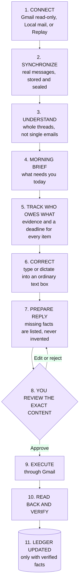
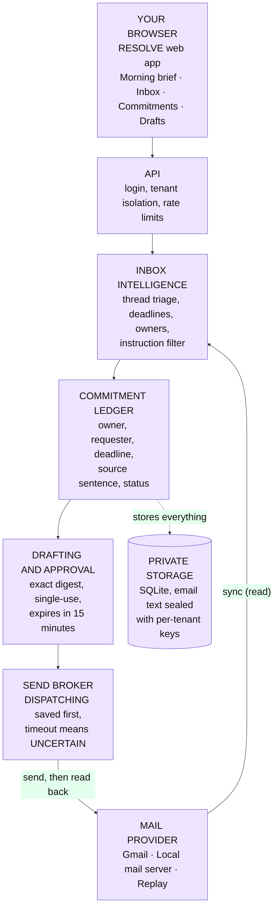
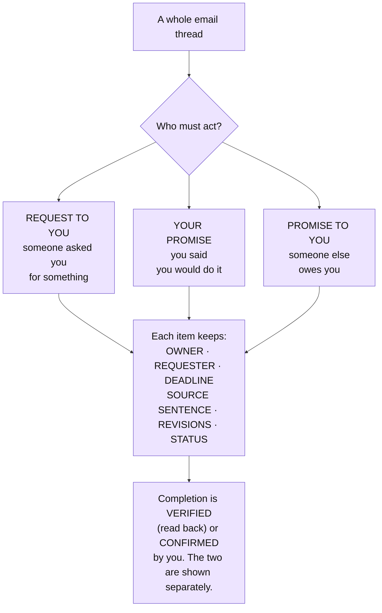
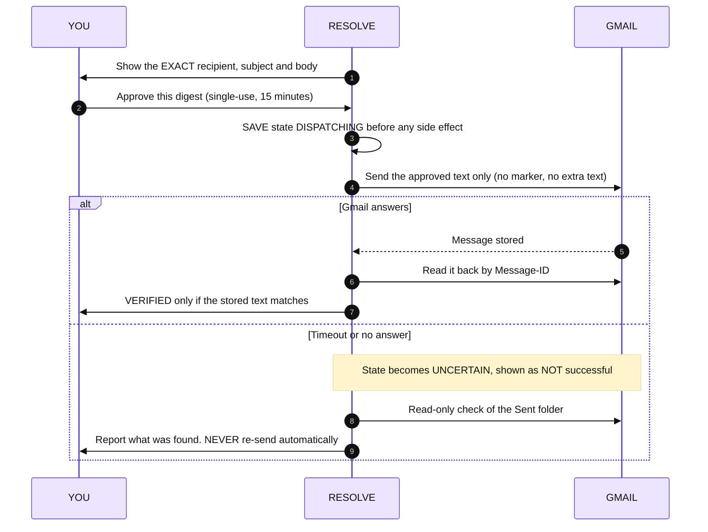
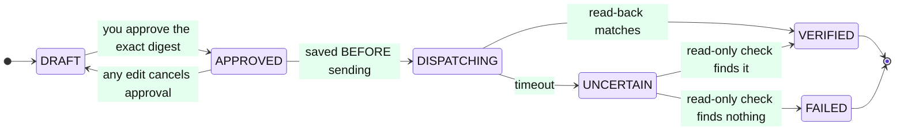
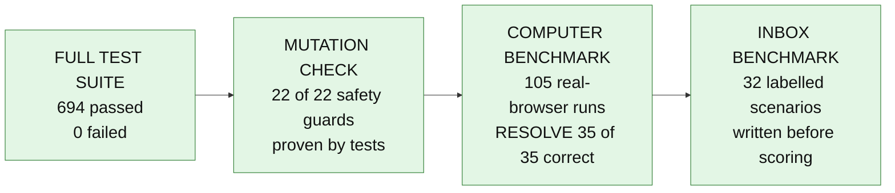

<div align="center">


<br><br>


<br><br>

<a href="docs/readme/intro.mp4">
  
</a>

**▶ [Watch the intro video (MP4, about 1 minute)](docs/readme/intro.mp4)** &nbsp;·&nbsp; real app, synthetic REPLAY data, nothing mocked up

# RESOLVE

### Inbox-to-Commitment Operator
**From inbox noise to verified follow-through.**

</div>

---

## In one minute

Email quietly turns into promises. Someone asks you for a file by Thursday. You say "I'll send it" and forget. A colleague promises you something and never does. Inbox tools show **messages**; nobody tracks **who owes what**.

**RESOLVE reads your mailbox, works out who owes what to whom, and shows you only what needs a decision.** It drafts replies, but it sends **only the exact text you approved**, then reads the sent message back from the mail provider and records **only what it could verify**.

| You | RESOLVE |
|---|---|
| Open the **Morning brief** | Shows what needs you, what you promised, what you are waiting for, what is overdue |
| Say or type a correction ("show deadlines first") | Turns it into a rule **preview**; nothing is active until you approve it |
| Click **Prepare reply** | Drafts from the thread; lists missing facts instead of inventing them |
| Approve the **exact content** | Sends exactly that, once, through Gmail (or simulates it in Replay) |
| Look at the result | Sees **verified**, or **uncertain**, never a guess |

**Who it is for:** independent developers, indie founders and small technical teams who run their work through email.

---

## The product journey



---

## Architecture

Everything below runs in **one process on your machine** (or one container). The browser is only a window onto it.



**Plain-words tour**

| Part | What it does | Why it matters |
|---|---|---|
| **Inbox intelligence** | Reads whole threads and finds requests and promises. Vague deadlines are **flagged, not invented**. Automated notices create nothing. | You are not flooded with false tasks. |
| **Commitment ledger** | Keeps three kinds apart (see below), each with owner, deadline, source sentence and revisions. | Every item can be traced to the sentence that caused it. |
| **Drafting and approval** | Builds a reply from the thread and from facts you give. Approval covers the **exact recipient, subject, body and digest**. Any edit cancels it. | You can never approve one thing and send another. |
| **Send broker** | Saves `DISPATCHING` **before** sending. After a timeout it checks the sent folder read-only. It **never** re-sends by itself. | No duplicate emails, no false "sent". |
| **Private storage** | Email text is sealed at rest. It is never logged and never sent to a model. | Your mail stays yours. |

---

## Who owes what



---

## Why you can trust a "sent" label





---

## Three ways to run it

| Mode | Needs | What is real | Good for |
|---|---|---|---|
| **Replay** | nothing | the same code path as live; **sends are SIMULATED** and labelled | trying everything in 2 minutes |
| **Local mail** | nothing | a **real** mail server on your machine (SMTP + POP3 on loopback, Maildir on disk); real delivery and read-back | seeing a full verified send without any account |
| **Gmail** | 3 OAuth variables and a test account | read-only by default; compose and send only if you turn them on | real use (**not yet verified live in this repo**) |

The engine is **RULES_ONLY** unless you point it at your own model endpoint (`RESOLVE_MODEL_BASE_URL`, `RESOLVE_MODEL_NAME`). Every result states which engine produced it: `RULES_ONLY`, `MODEL_ENABLED` or `REPLAY`.

---

## Quick start

```bash
python -m venv .venv && . .venv/bin/activate
pip install -r requirements-dev.txt
python src/resolve_app.py
```

Open **http://127.0.0.1:8765/app**, then **Replay lab → Start → Step** and look at **Morning brief**.

| Variable | Purpose |
|---|---|
| `GOOGLE_OAUTH_CLIENT_ID`, `GOOGLE_OAUTH_CLIENT_SECRET`, `GOOGLE_OAUTH_REDIRECT_URI` | Live Gmail. Without them the app shows GMAIL NOT CONFIGURED |
| `RESOLVE_MASTER_KEY` | Encryption key. **Required in production** |
| `RESOLVE_INBOX_DB` | Inbox database path (default `data/inbox.sqlite3`) |
| `RESOLVE_PUBLIC_BASE` | Base URL for OAuth redirects |
| `RESOLVE_MODEL_BASE_URL`, `RESOLVE_MODEL_NAME` | Optional Ollama, llama.cpp or OpenAI-compatible endpoint |

Set your timezone in **Privacy & settings**. Until you do, the app says UTC is in use.

**Regenerate the intro video** from the running app (needs Chromium and `ffmpeg`):

```bash
python scripts/record_intro_video.py
```

---

## What is verified (all measured, nothing assumed)



| Check | Result | Command |
|---|---|---|
| **Full test suite** | **694 passed, 24 skipped, 0 failed** (skips: 12 need the speech model, 3 need tkinter, 9 need native Windows) | `python -m pytest tests -q` |
| **Mutation check** | **22 of 22** deliberately broken safety checks were caught by the tests | `python scripts/mutation_check.py` (report: [`docs/MUTATION_REPORT.md`](docs/MUTATION_REPORT.md)) |
| **Computer benchmark** | 105 real-Chromium runs. Naive agent 3/35 correct, target-guard 15/35, **RESOLVE 35/35** with no wrong-target, duplicate or false-success results | `python benchmarks/computer_bench.py` (report: [`docs/COMPUTER_BENCHMARK.md`](docs/COMPUTER_BENCHMARK.md)) |
| **Inbox benchmark** | 31 of 32 new scenarios correct; the one miss is kept visible. 9 of 12 earlier fixtures fully pass; the 3 failures are not tuned away | `python benchmarks/inbox_metrics.py` (report: [`docs/INBOX_BENCHMARK_REPORT.md`](docs/INBOX_BENCHMARK_REPORT.md)) |
| **Send path** | no false success and no duplicate send in six scripted scenarios | `tests/test_send_broker.py` |

These are controlled, labelled fixtures in this repository, **not real inboxes** and **not commercial agents**. Browser actions are DOM-level Playwright actions, not physical cursor movement.

### What is NOT verified (do not assume it works)

| Item | Status |
|---|---|
| Live Gmail account | **BLOCKED**: needs your OAuth credentials and a test account |
| Model-assisted understanding or drafting | **NOT MEASURED**: no model endpoint configured |
| Speech recognition re-check on this commit, Docker smoke re-check | **BLOCKED in the last sandbox** (model download and Docker daemon unavailable). Earlier passes are recorded as history in [`docs/DEPLOYMENT.md`](docs/DEPLOYMENT.md) |
| Live microphone with real hardware | **NOT TESTED** |
| Native Windows input (UI Automation, Win32) | `WINDOWS_NATIVE_TESTS_NOT_RUN` |
| Public deployment | **NOT DONE** (needs your hosting account and master key) |
| Wispr Flow | RESOLVE has **no Wispr SDK integration**. Wispr Flow dictates into ordinary text fields. The Insights screenshot and demo recording must come from your real account ([`docs/WISPR_DEMO_SCRIPT.md`](docs/WISPR_DEMO_SCRIPT.md)) |

---

## Security in plain words

- Email text is **untrusted data**. Sentences that look like instructions are kept out of obligations and sent to human review.
- Email bodies, subjects and evidence are **never logged**, **never sent to a model**, and **sealed at rest** with per-tenant keys. Tokens are never returned by any route.
- One user can never reach another user's data (cross-user and cross-workspace requests return 404).
- Approval is tied to the exact digest, used once, expires, and is refused after any edit.
- Outgoing messages carry **no marker and no extra text**. Matching uses an RFC 822 Message-ID header.
- The database file itself is not fully encrypted; only sensitive content fields are sealed. Details and limits: [`docs/INBOX_SECURITY.md`](docs/INBOX_SECURITY.md).

## Known limitations

- Live Gmail behavior of Message-ID correlation and `rfc822msgid:` search must be confirmed with a test account; if it differs, read-back fails safe and the result stays UNCERTAIN.
- Follow-ups are recorded but not delivered. The unread filter is not offered. Pending OAuth state is kept in memory.
- Instruction detection is a phrase list, not a security boundary.
- The computer benchmark compares baselines written for this repo on controlled local apps (5 seeds per scenario). It does not compare against commercial agents.

---

## Advanced tools (secondary, kept and tested)

The default experience is the inbox journey above. These also exist, grouped under **Advanced tools** in the app:

| Tool | What it is | Where |
|---|---|---|
| **Live computer** | A real cloud Chromium runs tasks on three controlled demo apps with exact-digest approval, stale-target refusal and database-side verification | [`docs/COMPUTER_TASKS.md`](docs/COMPUTER_TASKS.md) |
| **Document Studio** | Reorder, extract, merge, compare and create PDFs with SHA-256 receipts. Print status never claims a physical printer confirmed | `src/document_studio.py` |
| **Voice** | Offline Vosk recorded-audio transcription (needs the model from `python scripts/fetch_stt_model.py`) | [`docs/VOICE.md`](docs/VOICE.md) |
| **Skills, missions, simulator** | Recorded browser skills and the developer simulator | [`docs/SKILLS.md`](docs/SKILLS.md) |
| **Windows desktop control** | UI Automation and Win32 input (Windows only) | [`docs/WINDOWS_CONTROL.md`](docs/WINDOWS_CONTROL.md) |

## Glossary

| Word | Meaning |
|---|---|
| **Digest** | A short fingerprint of exact content. Change one letter and it changes, so two things can be proven identical. |
| **Approval** | Your yes for one exact message. If the message changes, your yes no longer counts. |
| **Verified** | RESOLVE re-read the result from the provider and it matched what you approved. |
| **Uncertain** | It may have happened but cannot be proven. RESOLVE checks read-only and never retries on its own. |
| **Replay** | A labelled synthetic mailbox that runs through the same code as a real one. Sends are simulated. |
| **Tenant** | Your private area. Other users cannot see it. |

## Documentation

- [`docs/INBOX_OPERATOR_DEMO.md`](docs/INBOX_OPERATOR_DEMO.md): walk-through
- [`docs/INBOX_OPERATOR_SETUP.md`](docs/INBOX_OPERATOR_SETUP.md): setup and Gmail configuration
- [`docs/INBOX_API.md`](docs/INBOX_API.md): routes
- [`docs/INBOX_SECURITY.md`](docs/INBOX_SECURITY.md): security model and limits
- [`docs/INBOX_BENCHMARK_REPORT.md`](docs/INBOX_BENCHMARK_REPORT.md) · [`docs/COMPUTER_BENCHMARK.md`](docs/COMPUTER_BENCHMARK.md) · [`docs/MUTATION_REPORT.md`](docs/MUTATION_REPORT.md): measured results
- [`docs/INBOX_OPERATOR_TRACKER.md`](docs/INBOX_OPERATOR_TRACKER.md): done, partial, blocked
- [`docs/DEPLOYMENT.md`](docs/DEPLOYMENT.md): container and hosting
- [`docs/HANDOFF_NEXT_ACCOUNT.md`](docs/HANDOFF_NEXT_ACCOUNT.md): exact current state and next steps
- [`PROGRESS.md`](PROGRESS.md) · [`TASKS.md`](TASKS.md) · [`AGENTS.md`](AGENTS.md)

<div align="center"><sub>Built for the WeMakeDevs × Wispr Flow "No Hands" hackathon. Sample data is synthetic and labelled. Sends in Replay are simulated.</sub></div>
